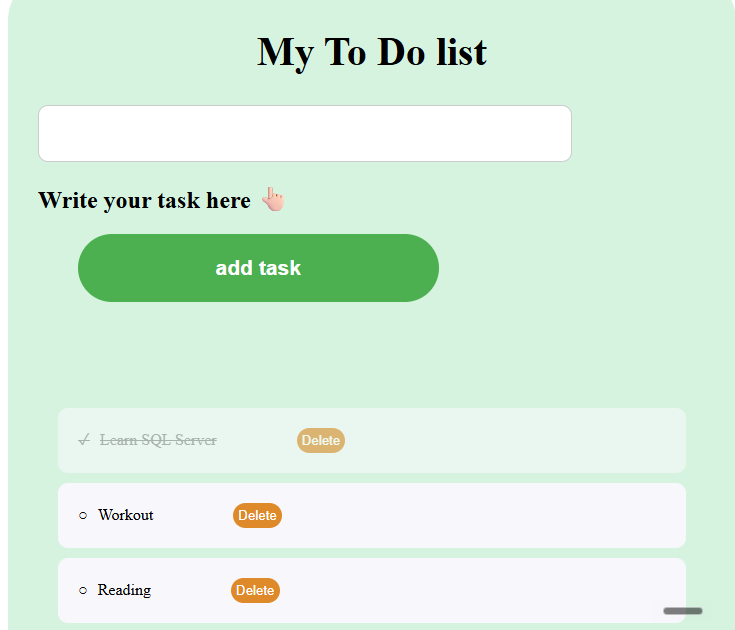
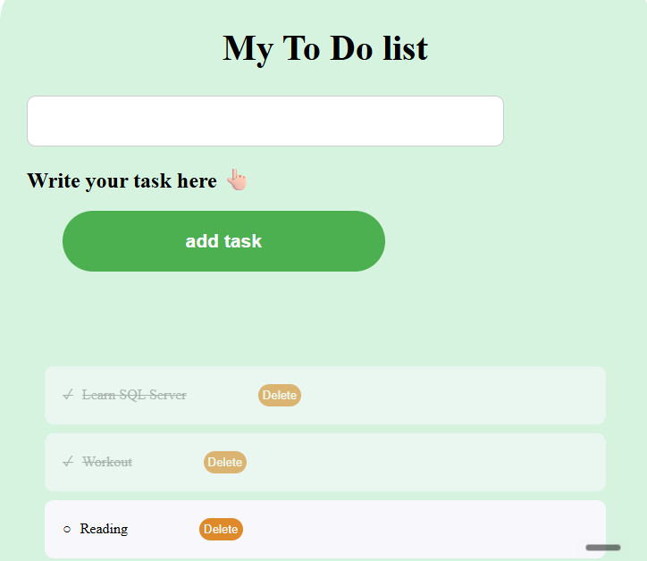
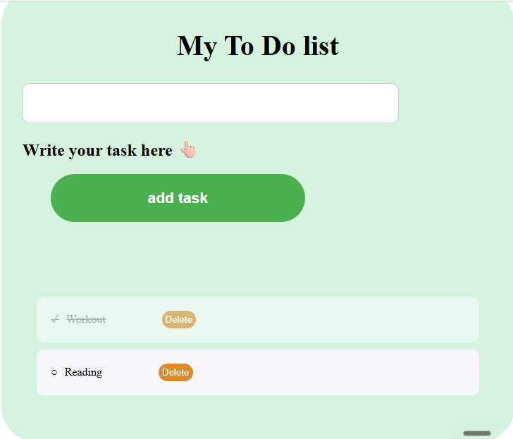

# Full-Stack To-Do List Application

A full-stack web application built using HTML, CSS, JavaScript, ASP.NET Core, Entity Framework Core, and SQL Server.

This project was developed to practice full-stack application development, RESTful APIs, database integration, and CRUD operations.

## Features

- Add new tasks
- View existing tasks
- Mark tasks as completed or incomplete
- Delete tasks
- Save tasks permanently in SQL Server
- Retrieve saved tasks after restarting the backend

## Application Screenshots

### Task List

### Completed Tasks

### Task Deletion

## Technologies Used

**Frontend**
- HTML5
- CSS3
- JavaScript

**Backend**
- C#
- ASP.NET Core Minimal API
- RESTful API

**Database**
- Microsoft SQL Server
- Entity Framework Core
- EF Core Migrations

**Development Tools**
- Visual Studio Code
- SQL Server Management Studio (SSMS)
- Git and GitHub

## API Endpoints

| Method | Endpoint | Description |
|---|---|---|
| GET | `/todos` | Retrieve all tasks |
| GET | `/todos/{id}` | Retrieve a task by ID |
| POST | `/todos` | Create a new task |
| PUT | `/todos/{id}` | Update an existing task |
| DELETE | `/todos/{id}` | Delete a task |

## How to Run Locally

1. Install the .NET 10 SDK and SQL Server.
2. Clone the GitHub repository.
3. Configure the SQL Server connection string in `todo-api/appsettings.json` for your local environment.
4. Open a terminal in the `todo-api` folder.
5. Restore dependencies using `dotnet restore`.
6. Apply database migrations using `dotnet ef database update` (EF Core CLI tools are required).
7. Start the backend using `dotnet run`.
8. Open `index.html` using VS Code Live Server.

The backend must be running for the frontend to communicate with the API.

## Project Status

**Completed — Local Full-Stack Application**

The application has been developed and tested locally, including all five REST API endpoints and SQL Server data persistence.

The source code, database migrations, setup instructions, and application screenshots are provided in this repository for portfolio review.

This project is not publicly hosted. Developers can run it locally by following the setup instructions.
## Future Improvements

- Improved error handling
- User authentication and authorization
- Automated testing
- Public deployment
